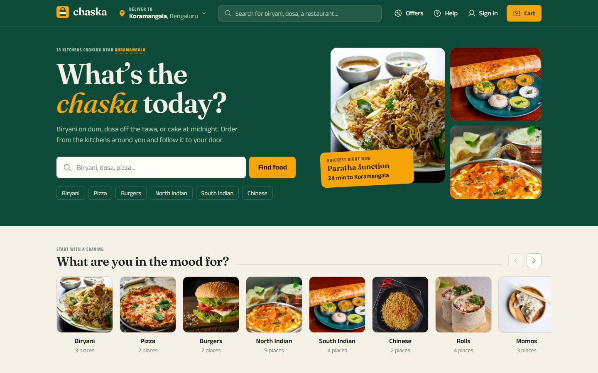
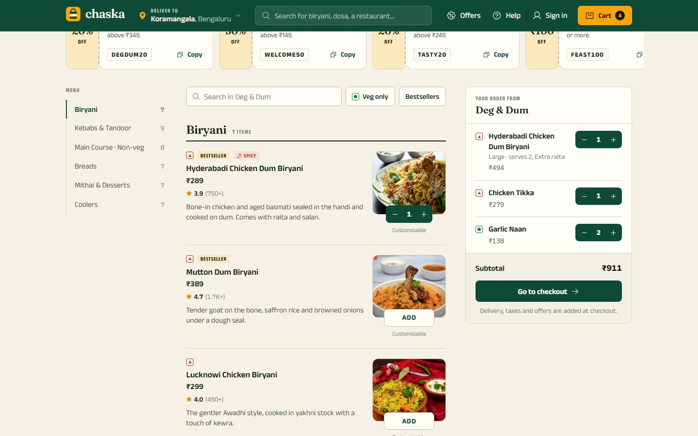
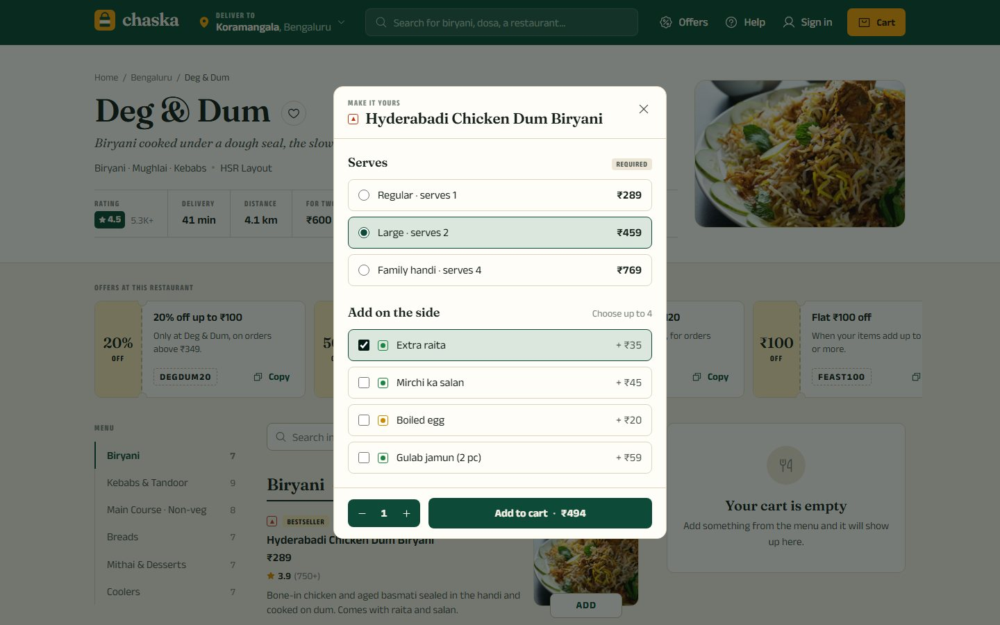
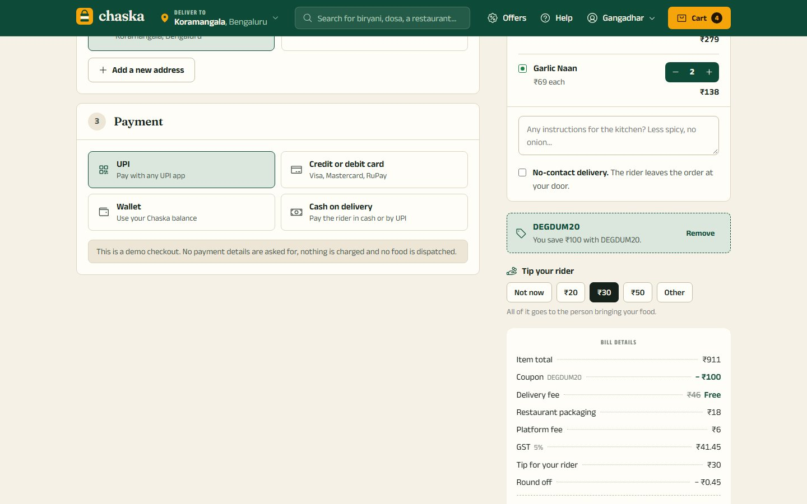
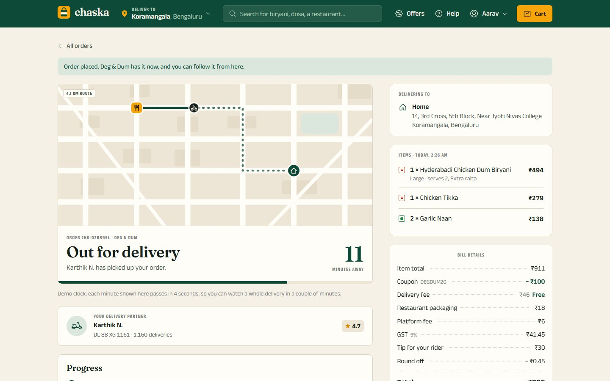
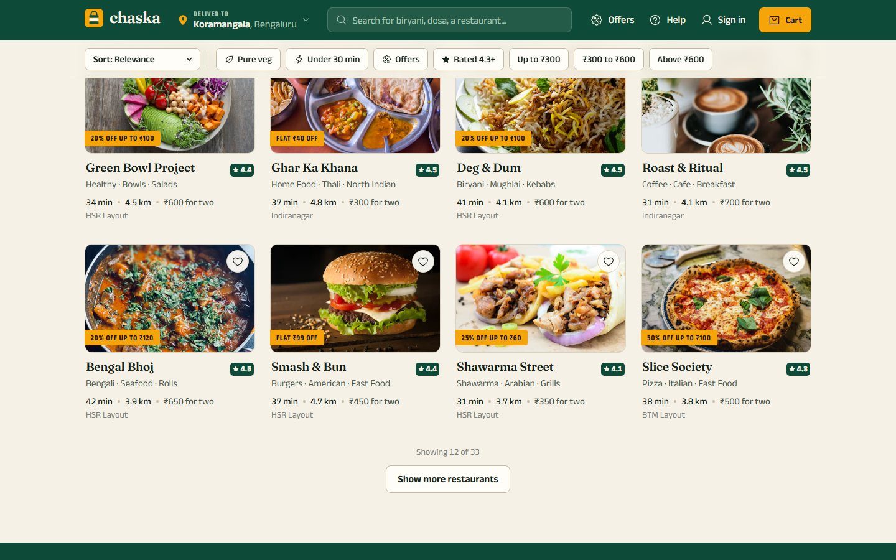
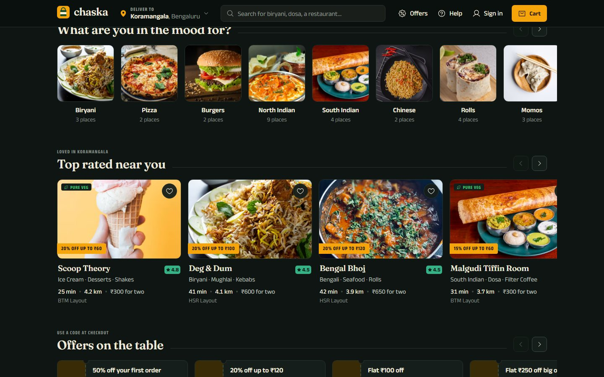
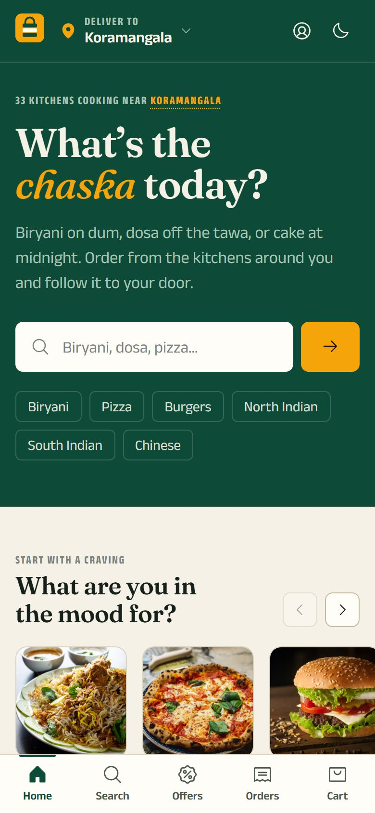
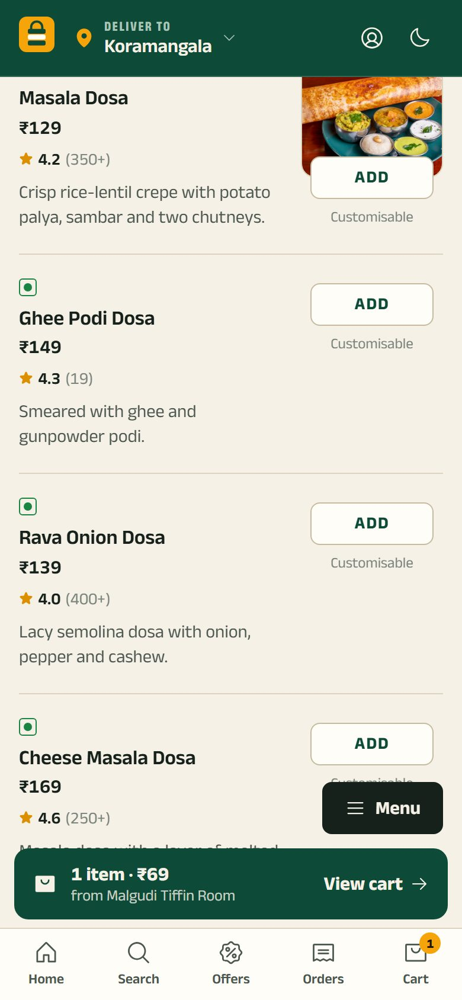
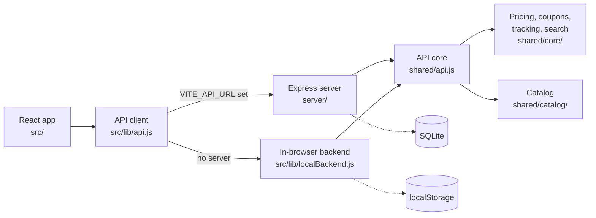

# Chaska

**A food ordering and delivery web app.** Browse restaurants around you, customise dishes, apply coupons, check out, and follow the rider on a live map until the order reaches your door.

*Chaska* (चस्का) is Hindi for a taste you keep going back for.



## What it does

- **Location-aware listings.** Eight cities, 48 delivery areas and 248 restaurant outlets. Every restaurant sits at a fixed point in its city, so distance, delivery time and delivery fee change with the area you pick.
- **Browsing.** Cuisine collections, top rated and quickest rails, and a restaurant grid with sorting and filters (pure veg, rating, delivery time, cost, offers). Filters live in the URL, so a filtered list can be shared or bookmarked.
- **Search** across restaurants and dishes, with type-ahead suggestions and recent searches.
- **Menus.** 37 restaurant brands with close to a thousand dishes between them: veg and non-veg marks, bestsellers, sold-out items, an in-menu search and a veg-only switch.
- **Customisation.** Sizes and add-ons with per-group limits, priced live as you choose.
- **Cart.** One restaurant per cart, with a prompt before replacing it. The cart survives a reload.
- **Coupons.** Percentage, flat, free-delivery, restaurant-only and first-order coupons, each with clear reasons when one cannot be applied.
- **Checkout** with saved addresses, cooking instructions, no-contact delivery, rider tip and an itemised bill.
- **Live order tracking.** A map with the rider moving along the route, a countdown, a progress timeline, cancellation while it is still allowed, and a rating once the order arrives.
- **Accounts.** Sign up and sign in, profile, address book, favourite restaurants, order history and one-tap reorder.
- **Light and dark themes**, a phone layout with a tab bar and bottom sheets, keyboard access and reduced-motion support.

| | |
|---|---|
|  |  |
|  |  |
|  |  |

<p>
  
  &nbsp;&nbsp;
  
</p>

## Stack

| Layer | Built with |
|---|---|
| Web app | React 19, React Router 7, TanStack Query 5, Tailwind CSS 4, Vite 7 |
| API | Node.js, Express 5 |
| Database | SQLite, through the driver built into Node (`node:sqlite`) |
| Auth | scrypt password hashes and HMAC-signed session tokens, both from `node:crypto` |
| Tests | Node's built-in test runner |

There are only ten runtime dependencies. Routing on the server side, validation, hashing, tokens and rate limiting are written out in this repository instead of being pulled in.

## How it is put together

The API is written once, in [`shared/api.js`](shared/api.js), as plain functions that know nothing about HTTP or about where data is stored. It is handed two things: a **store** (users, addresses, favourites, orders) and an **environment** (clock, ids, password hashing, session tokens).



That gives two ways to run the same application:

- **Full stack.** Express serves the API with SQLite behind it, and in production also serves the built web app.
- **Static demo.** With no API URL configured, the web app loads the same API core in the browser and keeps its data in `localStorage`. It can be hosted as plain static files, with no server at all.

Routes, validation and business rules are identical in both, because they are literally the same code. The test suite exercises the core directly and then again over HTTP.

A few decisions worth knowing about:

- **The server decides every price.** The browser keeps prices in the cart only to feel instant. The bill always comes from `POST /quote`, and placing an order re-prices the cart and refuses if the total has changed since the customer last saw it.
- **Order status is a function of time.** An order's timetable is fixed when it is placed, and its status is computed from the clock whenever it is read. There are no background jobs to keep alive, which is also what lets tracking work in the static demo.
- **Deliveries run on a demo clock.** One minute on screen lasts four real seconds by default, so a 30 minute delivery plays out in two. Set `ORDER_SECONDS_PER_MINUTE=60` for real time.
- **The catalog is generated, deterministically.** Restaurants draw their menus from a shared dish library using seeded randomness, so every machine, the server and the browser all produce exactly the same restaurants, prices and ratings.

## Run it locally

You need Node.js 22.13 or newer.

```bash
git clone https://github.com/Gangadhar017/Chaska-Food-Delivery.git
cd Chaska-Food-Delivery
npm install
npm run dev
```

Open http://localhost:5173. This starts the API on port 4000 and the web app on 5173, with the SQLite database created in `data/` on first run.

| Command | What it does |
|---|---|
| `npm run dev` | API and web app together, with reload on change |
| `npm run dev:web` | Web app only, in static demo mode (no server) |
| `npm test` | Run the test suite |
| `npm run lint` | Lint everything |
| `npm run build` | Build the web app into `dist/` |
| `npm start` | Run the API server; it also serves `dist/` if it exists |

### Demo account

A demo account with two saved addresses is created on first run.

| Email | Password |
|---|---|
| `demo@chaska.app` | `chaska-demo` |

### Configuration

All optional. See [`.env.example`](.env.example).

| Variable | Default | Purpose |
|---|---|---|
| `VITE_API_URL` | unset | API base URL for the web app. Unset means static demo mode. |
| `PORT` | `4000` | Port for the API server |
| `DATA_DIR` | `data` | Where the SQLite file and the generated signing secret live |
| `AUTH_SECRET` | generated | Secret for signing session tokens |
| `ORDER_SECONDS_PER_MINUTE` | `4` | Speed of the delivery clock. `60` is real time. |
| `CORS_ORIGIN` | unset | Allow one other origin to call the API |

## API

All routes are under `/api`. Routes marked 🔒 need an `Authorization: Bearer <token>` header. Errors come back as `{ "error": { "code", "message" } }` with a matching HTTP status.

| Method | Route | |
|---|---|---|
| GET | `/meta` | Cities, areas, cuisines, payment methods |
| GET | `/home?locality=` | Rails for the home page |
| GET | `/restaurants?locality=&cuisine=&sort=&veg=&rating=&fast=&offers=&cost=&page=` | Filtered, paginated list |
| GET | `/restaurants/:id?locality=` | Restaurant, menu and coupons |
| GET | `/search?locality=&q=` | Restaurants and dishes |
| GET | `/suggest?locality=&q=` | Type-ahead suggestions |
| GET | `/coupons?outlet=` | Coupons that can be used |
| POST | `/quote` | Price a cart: lines, coupon, fees, taxes, total |
| POST | `/auth/register` · `/auth/login` | Returns `{ token, user }` |
| GET · PATCH | `/me` 🔒 | Profile |
| GET · POST | `/me/addresses` 🔒 | Address book |
| PUT · DELETE | `/me/addresses/:id` 🔒 | |
| GET | `/me/favourites` 🔒 | |
| PUT | `/me/favourites/:id` 🔒 | Body `{ "on": true }` |
| GET · POST | `/orders` 🔒 | History, and placing an order |
| GET | `/orders/:id` 🔒 | Order with live tracking |
| POST | `/orders/:id/cancel` 🔒 | Allowed until the kitchen starts |
| POST | `/orders/:id/rating` 🔒 | Allowed once delivered |

## Project layout

```
shared/            code that runs in both the browser and Node
  api.js             every route, with validation and business rules
  memoryStore.js     storage adapter used by the browser and the tests
  catalog/           cities, restaurants, the dish library, coupons, photos
  core/              pricing, coupons, order tracking, listing and search
server/            Express shell, SQLite store, password and token handling
src/               the React app
  app/               session and delivery-location providers
  lib/               API client, cart store, data hooks, formatting
  components/        cards, dialogs, menu rows, bill, map, forms
  pages/             one file per screen
tests/             catalog, pricing, API and HTTP tests
```

## Tests

```bash
npm test
```

42 tests cover the catalog's integrity, line pricing with sizes and add-ons, every coupon rule, the bill arithmetic, the order lifecycle, the whole API (accounts, addresses, favourites, quotes, orders, cancellation, ratings, and who is allowed to see what), and the same flows again over HTTP against a real SQLite file, including a restart in the middle.

## Deploying

- **Static demo on Vercel.** Import the repository; the defaults work. [`vercel.json`](vercel.json) sends every path to the app so deep links load.
- **Full stack on Render.** [`render.yaml`](render.yaml) is a blueprint for a single Node service that builds the web app and serves it together with the API. Render's free plan has no persistent disk, so the database starts empty after each restart and the demo account is created again.

## Credits

Photographs are from [Unsplash](https://unsplash.com). Type is [Fraunces](https://fonts.google.com/specimen/Fraunces) and [Anek Latin](https://fonts.google.com/specimen/Anek+Latin), both under the SIL Open Font License. Icons are [Phosphor](https://phosphoricons.com).

The restaurants, menus and people in this project are made up. It is a learning project and is not connected to any food delivery company. No payments are taken and nothing is delivered.

Built by [Gangadhar Singh](https://github.com/Gangadhar017).
